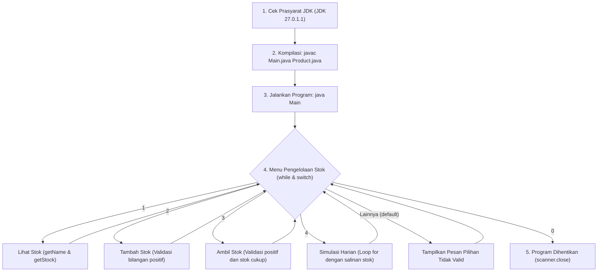
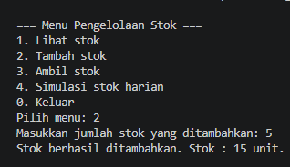
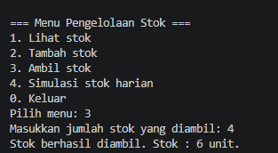
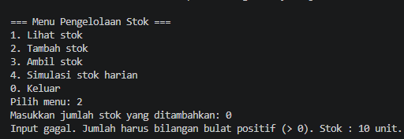
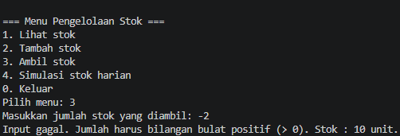
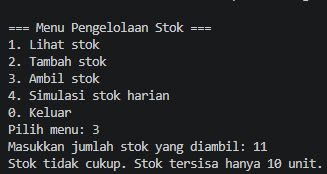
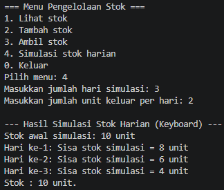
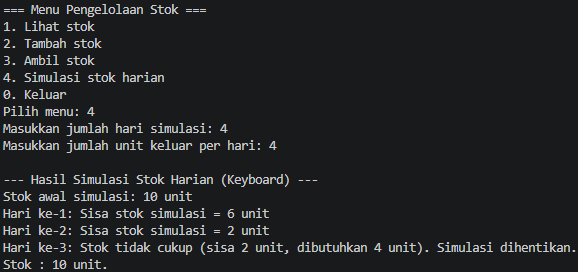
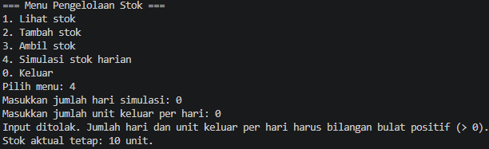
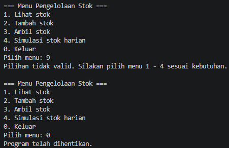

# Weekly Project: Create Java Basic Project OOP

**Program:** Back-End Web Development Bootcamp — Dibimbing  
**Subject:** Weekly Project : Create Java Basic Project OOP  
**Topik:** Java Control Flow, Java OOP  
**Author / Student:** Jihadul Hanif  
**Mentor:** Muhammad Arif Sulaksono  

---

## 🤖 Catatan Penggunaan AI (AI Disclosure)

**Pernyataan Penggunaan AI:**  
Dalam proses pengerjaan Weekly Project ini, penulis menggunakan AI secara terarah (pembelajaran) untuk:
1. Menggunakan AI untuk berdiskusi dan menjelaskan terkait penggunaan `private` serta `Scanner` dan contoh penggunaannya dalam *real case*.
2. Meminta AI untuk mengecek terkait kode `switch` dan `if/else` yang telah dibuat mandiri oleh penulis, terkait dengan *readability* dan keefektifan penulisan serta meminta AI untuk mereview jika ada kesalahan atau *error* yang terjadi.

---

## 📌 Ringkasan Program

Proyek ini merupakan program/aplikasi pengelolaan stok produk berbasis terminal (CLI) yang dibuat menggunakan bahasa pemrograman **Java** dengan penerapan konsep **OOP dasar** dan **Java Control Flow** (`if/else`, `switch`, `while`, dan `for`). Data stok disimpan di dalam memori selama program dijalankan.

* **Tujuan Program:** Membantu pengguna melihat stok aktual, menambah stok, mengambil stok dengan validasi ketersediaan, serta menjalankan simulasi pengurangan stok harian tanpa mengubah stok asli produk.
* **Data Awal:** 1 objek `Product` dengan nama **`Keyboard`** dan stok awal **`10` unit**.
* **Fitur yang Tersedia:** `1. Lihat stok`, `2. Tambah stok`, `3. Ambil stok`, `4. Simulasi stok harian`, dan `0. Keluar`.

### 1. Class Model (`Product.java`)
* Menyimpan data produk (`name` dan `stock`) sebagai atribut **`private`** dan menginisialisasinya melalui **constructor** `Product(String name, int stock)`.
* Menyediakan getter (`getName()`, `getStock()`) serta operasi stok tervalidasi (`addStock(int quantity)` dan `reduceStock(int quantity)`), terpisah dari logika input/output terminal.

### 2. Class Utama (`Main.java`)
* Membuat satu objek `new Product("Keyboard", 10)` dan membaca input pengguna di terminal menggunakan `Scanner`.
* Mengelola tampilan menu (`showMenu()`), perulangan menu utama (`while`), pemilihan aksi (`switch` + `default`), pemanggilan method `Product`, serta simulasi stok harian (`simulateDailyStock`) memakai `for` dengan salinan stok aktual.

---

## 📁 Struktur Repositori & Deliverables

Seluruh berkas proyek diletakkan pada root direktori agar mudah dikompilasi dan dijalankan sesuai panduan tugas:

```text
├── Main.java                                # Menu terminal, input Scanner, switch/while, & simulasi harian
├── Product.java                             # Class model produk (atribut private, constructor, getter, & operasi stok)
├── README.md                                # Dokumentasi proyek, panduan menjalankan, & bukti percobaan
└── screenshots/                             # Bukti screenshot terminal untuk seluruh 5 skenario uji
    ├── case-1a-tambah-stok.png
    ├── case-1b-ambil-stok.png
    ├── case-2a-tambah-nol.png
    ├── case-2b-ambil-negatif.png
    ├── case-2c-ambil-melebihi-stok.png
    ├── case-3-simulasi-3-hari.png
    ├── case-4a-simulasi-berhenti-hari-3.png
    ├── case-4b-simulasi-input-nol.png
    └── case-5-menu-tidak-valid.png
```

---

## ✨ Rincian Fitur, Validasi & Control Flow

1. **Enkapsulasi & Operasi Stok (`Product.java`):** Atribut `private String name` dan `private int stock` hanya diakses atau diubah melalui constructor, `getName()`, `getStock()`, `addStock(int quantity)`, dan `reduceStock(int quantity)`.
2. **Menu Interaktif (`while` + `switch`):** Perulangan `while (isRunning)` menampilkan ulang menu setelah setiap aksi. `switch (choice)` menangani menu `1`–`4` dan `0` (menghentikan loop lalu menutup `scanner.close()`), sedangkan `default` menolak pilihan di luar menu.
3. **Lihat Stok (Menu `1`):** Menampilkan nama produk dan stok aktual melalui `getName()` dan `getStock()`.
4. **Tambah Stok (Menu `2`):** Memvalidasi input wajib bilangan bulat positif (`> 0`) menggunakan `if/else`. Jika valid, stok bertambah lewat `addStock`; jika `0` atau negatif, input ditolak dan stok tetap.
5. **Ambil Stok (Menu `3`):** Menolak input `<= 0` dan menolak jumlah yang melebihi stok melalui `reduceStock` dengan pesan `"Stok tidak cukup"`, tanpa mengubah stok aktual.
6. **Simulasi Stok Harian (Menu `4`):** Memvalidasi `totalDays > 0` dan `unitsPerDay > 0`, menyalin stok aktual ke `int simulatedStock = product.getStock()`, lalu menjalankan `for (int day = 1; day <= totalDays; day++)`. Jika `simulatedStock < unitsPerDay`, menampilkan hari kejadiannya dan menghentikan simulasi (`break`), sementara stok aktual di `Product` tetap utuh.

---

## 🛠️ Tools yang Digunakan

* **Java SE Development Kit (JDK) `27.0.1.1`:** Compiler (`javac 27.0.1.1`) dan runtime (`java 27.0.1.1`) untuk mengompilasi dan menjalankan program Java di terminal.
* **Visual Studio Code:** Code editor untuk penulisan kode, kompilasi, dan pengujian melalui terminal.

---

## 🚀 Cara Menjalankan Program

### 1. Prasyarat
Pastikan **Java Development Kit (JDK)** sudah terpasang di komputer Anda. Proyek ini dikembangkan dan diuji menggunakan **Java SE JDK `27.0.1.1`** (kompatibel juga dengan JDK versi standar lainnya). Cek instalasi melalui terminal:

```bash
java -version
javac -version
```

### 2. Kompilasi dan Eksekusi
Dari root folder proyek, jalankan perintah berikut:

```bash
javac Main.java Product.java
java Main
```

### 3. Skema Alur Menjalankan Program

Berikut skema alur dari tahap kompilasi hingga interaksi menu aplikasi:



---

## 🧪 Ringkasan Hasil Pengujian (5 Skenario Wajib)

Pengujian dilakukan terhadap produk awal **`Keyboard`** dengan stok awal **`10` unit**. Setiap skenario terpisah dijalankan dari kondisi awal stok `10` unit.

| No | Skenario Pengujian | Input | Hasil yang Diharapkan | Hasil Uji | Status |
|:---:|:---|:---|:---|:---|:---:|
| **1A** | **Tambah stok valid (Case 1)** | Stok awal `10`, pilih menu `2`, jumlah `5` | Stok bertambah menjadi `15` unit dan menampilkan stok terbaru. | Menampilkan `"Stok berhasil ditambahkan. Stok : 15 unit."` | **✓ Sesuai** |
| **1B** | **Ambil stok valid – terpisah (Case 1)** | Stok awal `10`, pilih menu `3`, jumlah `4` | Stok berkurang menjadi `6` unit dan menampilkan stok terbaru. | Menampilkan `"Stok berhasil diambil. Stok : 6 unit."` | **✓ Sesuai** |
| **2A** | **Validasi tambah stok bernilai nol (Case 2)** | Stok awal `10`, pilih menu `2`, jumlah `0` | Input ditolak (wajib bilangan bulat positif `> 0`), stok aktual tetap `10` unit. | Menampilkan `"Input gagal. Jumlah harus bilangan bulat positif (> 0). Stok : 10 unit."` | **✓ Sesuai** |
| **2B** | **Validasi ambil stok bernilai negatif (Case 2)** | Stok awal `10`, pilih menu `3`, jumlah `-2` | Input ditolak (wajib bilangan bulat positif `> 0`), stok aktual tetap `10` unit. | Menampilkan `"Input gagal. Jumlah harus bilangan bulat positif (> 0). Stok : 10 unit."` | **✓ Sesuai** |
| **2C** | **Validasi ambil stok melebihi stok aktual (Case 2)** | Stok awal `10`, pilih menu `3`, jumlah `11` | Pengambilan ditolak dengan pesan `"Stok tidak cukup"`, stok aktual tetap `10` unit. | Menampilkan `"Stok tidak cukup. Stok tersisa hanya 10 unit."` | **✓ Sesuai** |
| **3** | **Simulasi stok harian – stok mencukupi (Case 3)** | Stok awal `10`, pilih menu `4`, hari `3`, unit keluar `2`/hari | Menampilkan sisa stok simulasi `8`, `6`, dan `4`; stok aktual tetap `10` unit. | Hari ke-1: `8`, Hari ke-2: `6`, Hari ke-3: `4`; stok aktual tetap `"Stok : 10 unit."` | **✓ Sesuai** |
| **4A** | **Simulasi stok harian – berhenti sebelum selesai (Case 4)** | Stok awal `10`, pilih menu `4`, hari `4`, unit keluar `4`/hari | Menampilkan sisa `6` dan `2`, berhenti pada hari ke-3 karena stok tidak cukup; stok aktual tetap `10` unit. | Hari ke-1: `6`, Hari ke-2: `2`, Hari ke-3: `"Stok tidak cukup (sisa 2 unit, dibutuhkan 4 unit). Simulasi dihentikan."`; `"Stok : 10 unit."` | **✓ Sesuai** |
| **4B** | **Validasi input simulasi bernilai nol (Case 4)** | Stok awal `10`, pilih menu `4`, hari `0`, unit keluar `0` | Input ditolak (wajib bilangan bulat positif `> 0`), stok aktual tetap `10` unit. | Menampilkan `"Input ditolak. Jumlah hari dan unit keluar per hari harus bilangan bulat positif (> 0)."` dan `"Stok aktual tetap: 10 unit."` | **✓ Sesuai** |
| **5** | **Pilihan menu tidak valid & keluar program (Case 5)** | Pilih menu `9`, lalu pilih menu `0` | Pilihan `9` ditolak dan menu tampil kembali; pilihan `0` menghentikan program. | Menampilkan `"Pilihan tidak valid. Silakan pilih menu 1 - 4 sesuai kebutuhan."`, menu tampil kembali, lalu setelah input `0` tampil `"Program telah dihentikan."` dan program berhenti. | **✓ Sesuai** |

---

### 📸 Bukti Screenshot Pengujian

#### Case 1 – Tambah Stok (`+5`) & Ambil Stok (`-4`)

**1A. Tambah 5 unit dari stok awal 10:**



**1B. Ambil 4 unit dari stok awal 10 (percobaan terpisah):**



#### Case 2 – Validasi Input Ditolak (`0`, `-2`, dan `11`)

**2A. Tambah 0 unit (ditolak, stok tetap 10):**



**2B. Ambil -2 unit (ditolak, stok tetap 10):**



**2C. Ambil 11 unit melebihi stok (ditolak, stok tetap 10):**



#### Case 3 – Simulasi Stok Harian (3 Hari, 2 Unit/Hari)



#### Case 4 – Simulasi Berhenti di Hari ke-3 & Validasi Input Nol

**4A. Simulasi 4 hari, 4 unit keluar per hari (berhenti pada hari ke-3):**



**4B. Simulasi dengan jumlah hari 0 dan unit keluar 0 (ditolak, stok tetap 10):**



#### Case 5 – Menu di Luar Pilihan (`9`) & Keluar Program (`0`)


